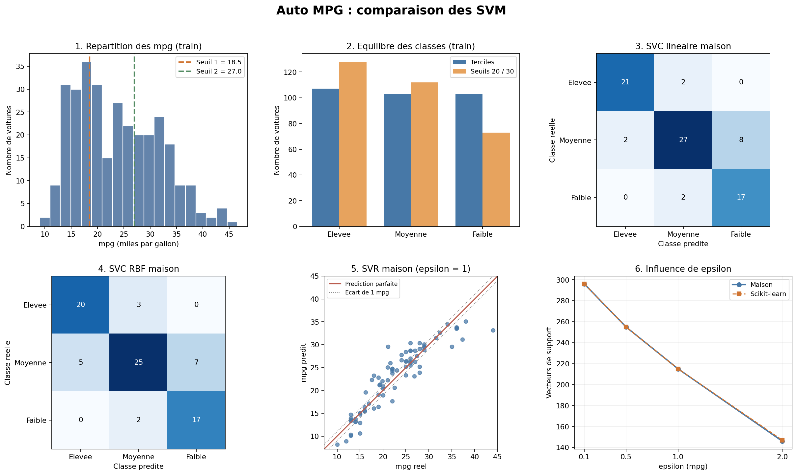
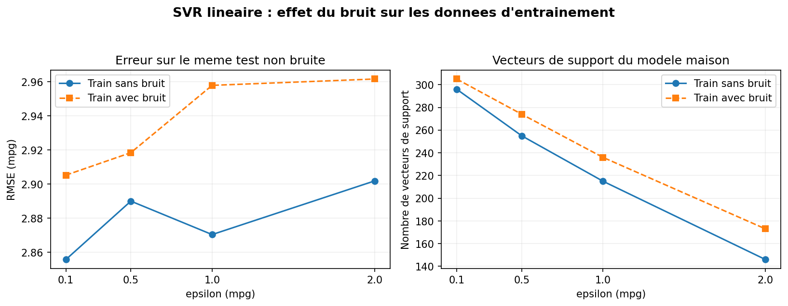

# Auto MPG — Classification et Régression SVM from Scratch

## Présentation du projet

Ce projet a pour objectif de prédire la consommation de carburant des véhicules à partir du jeu de données **Auto MPG**, en utilisant les machines à vecteurs de support (SVM).

Deux approches sont étudiées :

- **Classification (SVC)** : prédire une catégorie de consommation (faible, moyenne ou élevée).
- **Régression (SVR)** : estimer directement la consommation en miles par gallon (mpg).

Les modèles sont implémentés en Python, puis comparés aux implémentations de **scikit-learn** afin d'évaluer leurs performances.

## 1. Jeu de données

Le jeu de données Auto MPG est accessible avec Seaborn :

```python
import seaborn as sns
df = sns.load_dataset("mpg")
```

Après suppression des valeurs manquantes, le dataset contient **392 véhicules**.

Les caractéristiques utilisées sont :

- Cylindrée (`displacement`)
- Puissance (`horsepower`)
- Poids (`weight`)
- Accélération (`acceleration`)
- Année du modèle (`model_year`)
- Nombre de cylindres (`cylinders`)
- Origine (`origin`)

La variable cible est `mpg` (miles per gallon).

## 2. Prétraitement des données

Le prétraitement comprend :

1. Suppression des observations incomplètes.
2. Exclusion du nom des véhicules.
3. Standardisation des cinq variables numériques.
4. Encodage One-Hot des variables catégorielles.
5. Séparation des données : 80 % pour l'entraînement et 20 % pour le test.

Les transformations sont ajustées uniquement sur les données d'entraînement afin d'éviter les fuites de données.

## 3. Classification avec SVC

### Discrétisation de la variable cible

La variable continue `mpg` est transformée en trois catégories à partir des terciles du jeu d'entraînement :

| Classe | Condition |
|---|---|
| Consommation élevée | mpg ≤ 18,5 |
| Consommation moyenne | 18,5 < mpg ≤ 27 |
| Consommation faible | mpg > 27 |

Cette stratégie permet d'obtenir des classes relativement équilibrées pour l'entraînement.

### Modèles implémentés

Deux modèles SVC sont développés :

- **SVC linéaire** : recherche d'une frontière de séparation linéaire.
- **SVC avec noyau RBF** : prise en compte des relations non linéaires.

L'optimisation repose sur l'algorithme **SMO (Sequential Minimal Optimization)**.

La classification multiclasse est réalisée avec une stratégie **One-vs-One**.

### Résultats de classification

| Modèle | Accuracy | F1 macro |
|---|---:|---:|
| SVC linéaire — implémentation personnelle | 82,3 % | 0,827 |
| SVC linéaire — scikit-learn | 82,3 % | 0,827 |
| SVC RBF — implémentation personnelle | 78,5 % | 0,790 |
| SVC RBF — scikit-learn | 78,5 % | 0,790 |

Les deux implémentations personnelles donnent des résultats identiques à ceux de scikit-learn sur le jeu de test.

Le SVC linéaire obtient les meilleures performances dans cette expérience.

## 4. Régression avec SVR

### Principe du modèle

Le SVR linéaire cherche à prédire directement la consommation `mpg`.

Il utilise une fonction de perte epsilon-insensible :

\[
L_\epsilon(y,\hat{y}) = \max(0, |y-\hat{y}|-\epsilon)
\]

Les erreurs inférieures à epsilon ne sont pas pénalisées.

L'implémentation personnelle utilise une optimisation **ADMM (Alternating Direction Method of Multipliers)**.

### Influence du paramètre epsilon

| Epsilon | RMSE | R² | Vecteurs de support |
|---|---:|---:|---:|
| 0,1 | 2,856 | 0,840 | 296 |
| 0,5 | 2,890 | 0,836 | 255 |
| 1,0 | 2,870 | 0,839 | 215 |
| 2,0 | 2,902 | 0,835 | 146 |

Lorsque epsilon augmente, le modèle ignore davantage de petites erreurs et utilise généralement moins de vecteurs de support.

Cependant, une valeur plus grande d'epsilon ne garantit pas de meilleures performances prédictives.

## 5. Étude de la résistance au bruit

Un bruit gaussien d'écart-type 2 mpg est ajouté uniquement à la cible d'entraînement.

Les performances sont évaluées sur les données de test originales.

| Epsilon | RMSE sans bruit | RMSE avec bruit |
|---|---:|---:|
| 0,1 | 2,856 | 2,905 |
| 0,5 | 2,890 | 2,918 |
| 1,0 | 2,870 | 2,958 |
| 2,0 | 2,902 | 2,962 |

Les résultats montrent une légère augmentation de l'erreur avec le bruit.

La perte epsilon-insensible permet d'ignorer les petits écarts, mais une augmentation d'epsilon n'améliore pas systématiquement la précision.

## 6. Visualisation des résultats

Les graphiques présentent la distribution des données, les matrices de confusion, les prédictions SVR et l'influence du paramètre epsilon.

### Résultats des modèles



### Influence du bruit



## 7. Technologies utilisées

- Python
- NumPy
- Pandas
- Seaborn
- Matplotlib
- Scikit-learn
- Visual Studio Code

## 8. Installation et exécution

Cloner le dépôt :

```bash
git clone https://github.com/laylaa-code/Auto-MPG-Classification-R-gression-SVM-from-Scratch.git
```

Accéder au dossier du projet, puis installer les dépendances :

```bash
pip install -r requirements.txt
```

Exécuter le programme :

```bash
python main.py
```

Les résultats sont affichés dans le terminal et enregistrés dans les fichiers :

- `resultats.txt`
- `graphiques_resultats.png`
- `test_bruit.png`

## 9. Conclusion

Cette étude permet de comparer les approches SVC et SVR sur le jeu de données Auto MPG.

Le SVC linéaire atteint une précision de **82,3 %**, tandis que le SVR linéaire obtient un coefficient de détermination allant jusqu'à **R² = 0,840**.

Les résultats des implémentations personnelles sont très proches de ceux de scikit-learn.

L'étude met également en évidence l'importance du prétraitement, de la discrétisation de la cible et du choix du paramètre epsilon.

Les performances présentées correspondent au découpage entraînement/test utilisé et peuvent varier avec d'autres configurations.
